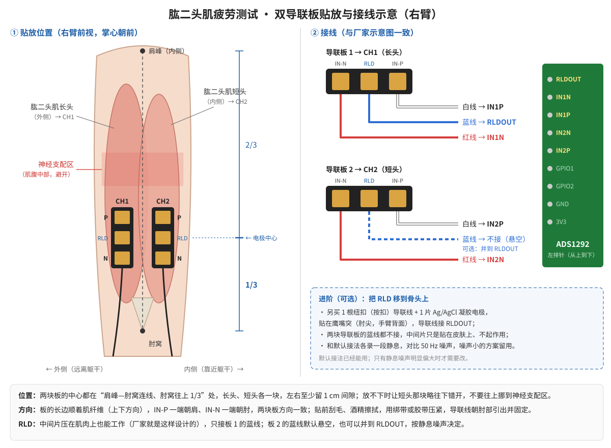

# hardware：ESP32-S3 + ADS1292 肌电采集设备端

用 ESP32-S3 驱动 ADS1292 双通道生物电模块，采集表面肌电（sEMG）并上传到电脑。本目录是 [EMGInsight](../README.md) 的设备端：仓库根目录的机器学习部分目前只用公开数据集做离线实验，设备端的目标是让它能用上自己采集的数据。本目录原为独立仓库 `ML_ADS1292`，2026-11-23 并入。

> 只用于研究和教学，不用于临床诊断。

| 目录 | 内容 | 是否进 Git |
| --- | --- | --- |
| `docs/` | 实施计划、与机器学习部分的匹配分析、电极贴放示意图 | ✅ |
| `vendor/` | 厂商资料包（ADS1292 模块资料、DNESP32S3 开发板手册与例程，约 700 MB） | ❌ 只在本地；新成员需向组员拷贝，放到 `hardware/vendor/` 下 |

本文指向 `vendor/` 的链接只能在已放置资料包的本地打开。

## 当前状态

| 项目 | 状态 |
| --- | --- |
| 开发环境 | ✅ ESP-IDF **v6.1**，目标芯片 `esp32s3`，可以编译 |
| ADS1292 驱动 | 🟡 已写完并能编译（[components/ads1292/](components/ads1292/)），**还没有上板验证** |
| 上电自检固件 | 🟡 [main/main.c](main/main.c)：读 ID、打印寄存器、每秒输出采样率和两路统计 |
| 数据上传 | ⬜ 未开始，方案见实施计划阶段 2 |
| 与 Zenodo 数据结合 | ⬜ 见 [实施计划](docs/实施计划-硬件与Zenodo数据结合.md) |

工程最初来自 IDF v6.1 官方示例 `spi_master/hd_eeprom`，示例的 EEPROM 驱动和入口文件已删除，只保留了组件化的结构。

**下一步：** 按 [实施计划](docs/实施计划-硬件与Zenodo数据结合.md) 阶段 1 上板验证（ID → 测试信号 → 输入短路 → 电极）。

## 硬件

| 部件 | 说明 | 资料 |
| --- | --- | --- |
| 主控 | 正点原子 DNESP32S3 开发板（ESP32-S3） | [vendor/development board/](vendor/development%20board/) |
| 采集模块 | ADS1292 生物电采集模块 V1.1：2 路差分输入 + 右腿驱动（RLD），24 位 ADC | [vendor/ADS1292模块资料包/](vendor/ADS1292模块资料包/) |
| 电极 | 一次性 Ag/AgCl 凝胶电极或厂家的金属导联板 | 见模块使用说明第 5 节 |

### 接线

ADS1292 单独使用 SPI3 总线。下表是固件的默认引脚，可以在 `idf.py menuconfig` → **ADS1292 Configuration** 中修改。

| ADS1292 模块引脚 | 方向 | 作用 | ESP32-S3 GPIO（默认） |
| --- | --- | --- | --- |
| 3V3 / GND | 电源 | 供电，与开发板共地 | 3V3 / GND |
| SCLK | 主→从 | SPI 时钟（模式 1，默认 2 MHz） | 4 |
| DIN | 主→从 | SPI MOSI | 5 |
| DOUT | 从→主 | SPI MISO | 6 |
| CS | 主→从 | 片选，低有效，由驱动手动控制 | 7 |
| DRDY | 从→主 | 数据就绪，下降沿表示一帧新数据，接 GPIO 中断 | 15 |
| START | 主→从 | 高电平开始转换；设为 -1 时改用 `START`/`STOP` 命令 | 16 |
| PWDN | 主→从 | 低电平掉电/复位，固件上电后拉高；设为 -1 表示不接 | 17 |
| CLKSEL | 主→从 | 高电平选内部时钟；默认 -1（不接，按模块自身的上拉/下拉） | 不接 |

**为什么选这些引脚：** 按 [DNESP32S3 V1.0 硬件参考手册](vendor/development%20board/DNESP32S3%20V1.0%20硬件参考手册.pdf) 表 1.2.2.1，开发板上几乎没有完全独立的 GPIO：

| GPIO | 占用 | 能否给 ADS1292 用 |
| --- | --- | --- |
| 4–7、15–18 | RGB 屏接口和摄像头接口 | ✅ 不插 RGB 屏和摄像头时可以用（**默认选这组**） |
| 11、12、13 | 板载 SPI2（SPI 屏、TF 卡） | ⚠ 可以共用总线，但会和 TF 卡抢总线 |
| 35、36、37 | 模组内部 PSRAM | ❌ 手册标注“勿用” |
| 19、20 | USB SLAVE 口 | ❌ 留给数据上传 |
| 0、2、3、45、46 | BOOT 键 / TF 卡 CS / strapping 引脚 | ❌ |
| 1、41、42、38–40 | LED、I²C、触摸 | ❌ |

接线前请对照开发板排针 P1 的丝印，确认这些 GPIO 都已引出。

### 采集注意事项（摘自厂家说明）

- **用不会休眠的充电宝供电。** 只靠电脑 USB 或手机充电器供电时，电源噪声会让波形满屏。调试串口需要连电脑时，优先考虑无线上传或隔离。
- **必须接 RLD**，不接时信号质量会严重变差。用单独的贴片电极时贴在骨骼突出处（如肘部鹰嘴突）；用厂家的三片式导联板时，RLD 是中间那片，压在肌肉上也能工作。
- 电极沿肌纤维方向贴在肌腹上，两电极间距 2–3 cm，正负极在同一块肌肉上；贴之前用酒精擦拭皮肤。
- 设备放在腿上或木桌上，远离金属桌面、充电器和变压器，以减少 50 Hz 工频干扰；固定好电极线，避免晃动。
- 厂家建议肌电采样率用 500 Hz 或 1000 Hz，量程从 ±200 mV 开始调。**做疲劳分析时采样率用 2000 SPS**：中值频率（MDF）是主要的疲劳指标，EMGInsight 按 20–450 Hz 计算。ADS1292 数字滤波器的 −3 dB 带宽约为 0.262 × 采样率（按芯片手册，请核对），1000 SPS 时只有约 262 Hz，频谱不完整，MDF 会偏低；2000 SPS 时约 524 Hz，够用。

#### 肱二头肌疲劳测试的贴放方法

适用于厂家的两块三片式导联板（每块从左到右为 IN-N、RLD、IN-P，导线为红、蓝、白）。



- **位置：** 两块板的中心都放在“肩峰到肘窝连线、从肘窝往上 1/3”处（参照 SENIAM 规范）。板 1 贴长头（外侧），接 CH1；板 2 贴短头（内侧），接 CH2。避开肌腹中部的神经支配区，电极跨在那里时幅值会偏小、频谱会失真。
- **方向：** 板的长边顺着肌纤维（上下方向），IN-P 朝肩、IN-N 朝肘，两块板方向一致，这样两路信号可以直接对比。
- **接线：** 板 1 白→IN1P、红→IN1N、蓝→RLDOUT；板 2 白→IN2P、红→IN2N，蓝线默认悬空。板 2 的蓝线也可以并联到 RLDOUT 来加大参考接触面积，但没有实测过，两种接法各录一段静息、对比 50 Hz 噪声后再决定。
- **尺寸：** 两块板并排时左右至少留 1 cm 间隙。放不下时，让短头那块稍微往下（往肘窝方向）错开，不要往上挪到神经支配区。
- **测试动作：** 开头先录 10 s 静息，作为个人基线。然后按用途二选一：
  - **要和 EMGInsight 的 Zenodo 数据比较（默认）：** 做动态屈肘直到坚持不住，与数据集 trial_5 一致；负重、节奏和角度范围固定下来并写进元数据。采集协议和保存格式见 [EMGInsight 项目概览与硬件匹配](docs/EMGInsight项目概览与硬件匹配.md) 第 6 节。
  - **只建自己的数据集：** 用等长收缩，肘关节固定在 90°，手持 30–50% 最大力量（MVC）的重物保持到力竭。肌肉不会在电极下滑动，频谱变化更能反映疲劳，但和 Zenodo 数据不可直接比较。
- **跨天重复测试**时，用记号笔标出导联板的位置，否则位置偏差会改变 MDF 的基线。

## 开发环境

电脑上通过 EIM 安装了两个 ESP-IDF 版本，**本项目使用 v6.1**，与 VS Code ESP-IDF 插件的选择一致（[.vscode/settings.json](.vscode/settings.json)）。

| 项目 | 路径 |
| --- | --- |
| ESP-IDF v6.1 | `E:\Espressif\.espressif\v6.1\esp-idf` |
| 工具链 | `C:\Espressif\tools`（xtensa-esp-elf GCC 15.2） |
| 终端激活脚本 | `C:\Espressif\tools\Microsoft.v6.1.PowerShell_profile.ps1` |

在 PowerShell 中进入 `hardware/` 目录再编译、烧录：

```powershell
. C:\Espressif\tools\Microsoft.v6.1.PowerShell_profile.ps1
cd hardware
idf.py build                   # sdkconfig 已进 Git，目标芯片为 esp32s3
idf.py -p COMx flash monitor   # COMx 换成开发板的串口号
```

- 不要在同一个 `build/` 里混用 v5.5.6 和 v6.1；切换版本时删掉 `hardware/build/` 再编译。
- `sdkconfig` 已设为 16 MB Flash（开发板实际容量），修改配置后连同 `sdkconfig` 一起提交。
- **VS Code：** 做固件开发时，用 **文件 → 将文件夹添加到工作区** 把 `hardware/` 加进来（或单独打开 `hardware/`），ESP-IDF 插件需要以 `hardware/` 作为工程目录。仓库忽略所有 `.vscode/`，所以 `hardware/.vscode/`（ESP-IDF 版本选择、IntelliSense 配置）只在本地。新环境中编辑器提示“无法打开源文件”时，在 `hardware/.vscode/c_cpp_properties.json` 中把 `compileCommands` 指向 `${workspaceFolder}/build/compile_commands.json`，先编译一次，再执行 **C/C++: Reset IntelliSense Database**。

## 目录结构

```text
hardware/
  CMakeLists.txt        ESP-IDF 工程入口，项目名 emginsight_hardware
  sdkconfig             工程配置（esp32s3、16 MB Flash、ADS1292 选项）
  main/
    main.c              上电自检：初始化 SPI3 和 ADS1292，每秒输出采样统计
    Kconfig.projbuild   menuconfig 中的 “ADS1292 Configuration”（引脚、采样率、增益、输入）
  components/ads1292/   ADS1292 驱动：寄存器读写与回读校验、启动/停止、DRDY 中断、原始码转 µV
  docs/
    实施计划-硬件与Zenodo数据结合.md
    EMGInsight项目概览与硬件匹配.md
    肱二头肌双通道贴放示意图.svg
  vendor/               （本地，不进 Git）
    ADS1292模块资料包/    芯片手册、模块原理图、通信协议、STM32/Arduino 参考程序、上位机与 APP
    development board/   DNESP32S3 硬件手册、使用指南、厂家 IDF 例程
  .vscode/              （本地，不进 Git）ESP-IDF 插件与 IntelliSense 配置
```

计划中还要新增（见实施计划阶段 2、3）：

```text
  components/emg_link/  上传链路：自定义二进制帧（序号 + CRC），经 USB SLAVE 口发送
  tools/recorder/       电脑端采集程序：收数据、记录按键评分、保存 CSV/JSON
```

## 固件开发指南

### 1. ADS1292 驱动要点

驱动在 [components/ads1292/](components/ads1292/)，接口见 [ads1292.h](components/ads1292/include/ads1292.h)。以芯片手册为准（[ads1292 芯片手册.pdf](vendor/ADS1292模块资料包/5%20电子硬件/ads1292%20芯片手册.pdf)），以下是驱动里处理过的要点，改代码时注意不要破坏：

- **SPI 模式 1**（CPOL=0，CPHA=1），默认 2 MHz。
- **多字节命令的每个字节之间要间隔 4 tCLK**（内部 512 kHz 时钟下约 7.8 µs），所以 CS 由驱动手动控制，逐字节发送并延时 8 µs。
- **上电默认是连续读数（RDATAC）模式，读写寄存器前必须先发 `SDATAC`（0x11）。**
- 常用命令：`RESET` 0x06、`START` 0x08、`STOP` 0x0A、`RDATAC` 0x10、`SDATAC` 0x11、`RREG` 0x20|addr、`WREG` 0x40|addr。
- 关键寄存器：`ID` 0x00（先读它验证接线）、`CONFIG1` 0x01（采样率）、`CONFIG2` 0x02（参考电压、测试信号）、`CH1SET`/`CH2SET` 0x04/0x05（PGA 增益、输入选择）、`RLD_SENS` 0x06（右腿驱动）。
- 每次 `DRDY` 下降沿读 9 字节：3 字节状态 + CH1 24 位 + CH2 24 位，都是有符号补码，高字节在前。
- 换算成微伏：`µV = code × VREF / (PGA × (2^23 − 1)) × 1e6`，VREF 默认 2.42 V。
- 调通顺序参考厂家说明：先读出寄存器值、确认和配置一致，再用内部短路或测试信号输入（`CHnSET` 输入选择）检查数据通路，最后接电极。

厂家 STM32 参考程序在 `vendor/ADS1292模块资料包/2 嵌入式程序/stm32f103/`（rar 压缩包），寄存器初始化顺序可以照着移植。

### 2. 采集与上传

- 在 `DRDY` 中断里只通知任务，由采集任务读 SPI，再写入环形缓冲；上传任务每次打包多个采样点发送。不要在中断里做 SPI 传输或打印日志。驱动已经按这个方式实现（中断只计数并释放信号量）。
- 数据量：2 通道 × 2000 SPS × 3 字节 ≈ 12 KB/s，再加上帧头开销。用 USB SLAVE 口（ESP32-S3 自带的 USB Serial/JTAG）或 Wi-Fi 都足够。
- **上传格式用自定义二进制帧**（带采样序号和 CRC，传原始 ADC 码），详见实施计划阶段 2。厂家协议传 float、没有序号，丢帧时无法发现，只在需要用厂家 RunE_Module 上位机看波形时再考虑兼容。

### 3. 厂家通信协议摘要

来源：[ADS1292模块-通信协议 20251029.docx](vendor/ADS1292模块资料包/4%20通信协议/)。

| 方向 | 结构 |
| --- | --- |
| 电脑 → 设备 | `0xAA` · 长度 · 指令（写 0x80 / 读 0x81）· 地址 · [内容] · 校验 · `0xBB` |
| 设备 → 电脑 | `0xA5` · 长度 · 地址 · 帧头校验 · [数据] · `0x5A` |

校验是异或：指令帧对“长度、指令、地址、内容”异或；数据帧的帧头校验只对“长度、地址”异或。

| 地址 | 含义 | 内容 |
| --- | --- | --- |
| 0x01 / 0x02 | 硬件 / 软件版本号 | 字符串 |
| 0x11 | 开始(0x01) / 停止(0x00) 采集 | 采集数据也以 0x11 地址返回：`ch × n` 个 float（4 字节，单位 µV） |
| 0x12（正文写作 0x10） | 采样参数 3 字节 | 采样率 0x00–0x05 = 125/250/500/1000/2000/4000 SPS；量程 0x00–0x06 = PGA 1/2/3/4/6/8/12；输入 0x00 电极 / 0x01 内部短路 / 0x02 测试信号 |

**协议文档有几处前后矛盾，实现时需要用 RunE_Module 实际抓包确认：**
- 采样参数的地址在总表里是 `0x12`，在正文示例里是 `0x10`。
- 设置采样参数的指令帧长度写的是 `0x05`，按“3 + N”的规则，内容 3 字节时应为 `0x06`。
- 采集数据中多个通道、多个采样点的排列顺序（逐点交错还是逐通道连续）没有写明。
- float 字节序没有写明（小端是按 STM32 推测的）。

## 与 EMGInsight 对接

> 详细分析见 [docs/EMGInsight项目概览与硬件匹配.md](docs/EMGInsight项目概览与硬件匹配.md)：EMGInsight 各任务能否用本硬件的数据、Zenodo 疲劳数据集逐项对比、推荐的采集协议和保存格式。**简短结论：现有模型中只有 E 任务的单路肱二头肌模型能对接，而且需要把 2000 SPS 数据重采样到 1259.26 Hz。** 目前的方案是不沿用现有模型、重新建立流程（按秒和 Hz 定义处理参数，不重采样），见 [实施计划](docs/实施计划-硬件与Zenodo数据结合.md)。

EMGInsight 的流程是：读取 → 按用户划分 → 分窗 → 提取特征（RMS/MAV/WL）→ scikit-learn 模型。接自采数据前，需要先解决以下差异：

| 问题 | 说明 | 建议 |
| --- | --- | --- |
| 通道数不同 | ADS1292 只有 2 路，现有模型分别用 8 路（手势）、24 路（指力）、4 路（疲劳）训练 | 现有模型**不能直接用**。可以用自采的 2 路数据重新训练，或参考 EMGInsight 计划中的“通道减少对比”，先在公开数据上评估只用 2 路时效果会下降多少 |
| 采样率 | 各公开数据集的采样率不同（例如 Zenodo 疲劳数据为 1259 Hz），分窗长度按采样点数计算 | 在元数据中记录实际采样率；按时间长度（毫秒）而不是点数设置窗口，或者重采样到目标数据集的采样率 |
| 单位与前端滤波 | 厂家协议输出的是 µV，公开数据集的单位和硬件滤波各不相同 | 统一在电脑端用 EMGInsight 的 `common.signal.bandpass` 滤波；保存原始值，不在固件里做不可逆的处理 |
| 用户划分 | EMGInsight 要求先按用户划分再分窗，同一用户不能同时出现在训练集和测试集 | 每次采集都必须记录 `subject_id` |
| 个人校准 | EMGInsight 发现用记录开头的静息段做个人校准是最有效的改进 | 每次采集开头先录 5–10 s 静息 |

建议电脑端把每次采集保存为一个 CSV 加一个元数据 JSON，放到 EMGInsight 的 `data/raw/<自采数据集名>/` 下，再按 EMGInsight 的结构新增一个任务包（`reading.py` → `windowing.py` → `check.py` …）：

```text
<subject_id>_<session>_<task>.csv     列：t_s, ch1_uV, ch2_uV, label
<subject_id>_<session>_<task>.json    采样率、PGA、输入模式、电极位置、固件版本、采集时间
```

字段名和标签含义需要和 EMGInsight 组员确认后再固定。

## 待办

完整计划见 [实施计划](docs/实施计划-硬件与Zenodo数据结合.md)，这里只列近期事项。

- [x] 编写 `components/ads1292` 和上电自检固件
- [x] 删除示例的 EEPROM 驱动和入口文件
- [ ] 对照开发板排针 P1 确认默认引脚已引出，按接线表接线
- [x] Flash 大小改为 16 MB
- [x] 并入 EMGInsight 仓库的 `hardware/`
- [ ] 阶段 1 硬件验证：ID → 测试信号 → 输入短路 → 电极
- [ ] 阶段 2 上传链路 `components/emg_link`
- [ ] 阶段 3 电脑端采集程序 `tools/recorder/`
- [ ] 和组员确认新任务包的名称和 Zenodo 读取代码是否移到 `common/`
