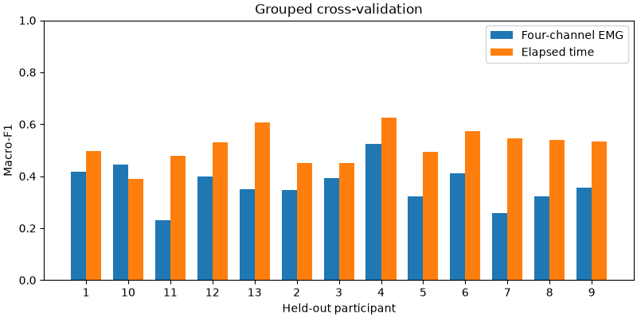

# E · 全试验自感疲劳分类

扫描 156 场，156 场提供有效窗口，共 23010 窗、13 人。排除原因及尾行修正见 [records.csv](records.csv)。

固定划分沿用原实验的 8/3/2 人，按验证用户平均 macro-F1 选型。另做四折按人嵌套验证，每折仅从外层训练人群抽取三人选型，再用该折全部训练人员重新拟合。每名参与者只贡献一次外层测试预测。

| 输入 | 固定测试 macro-F1 | 四折合并 macro-F1 | 四折逐人平均 macro-F1 |
|---|---:|---:|---:|
| 四路肌电 | 0.434 | 0.388 | 0.367 |
| 单路主动力肌 | 0.383 | 0.376 | 0.363 |
| 运动时间 kNN | 0.442 | 0.526 | 0.517 |
| 多数类 | 0.115 | 0.215 | 0.137 |

四路模型在 1/13 名外层测试用户上超过时间基线。逐人 F1 范围 0.229–0.524。模型预测试验中的主观评分；重叠窗口不独立，小样本和单一采集协议限制泛化。

[逐人指标](per_subject.csv) · [逐窗留出预测](grouped_predictions.csv) · [含三类召回率和混淆矩阵的指标](metrics.json) · [模型卡](model_card.json) · [复现与推理](../../../src/emginsight/fatigue/README.md)

