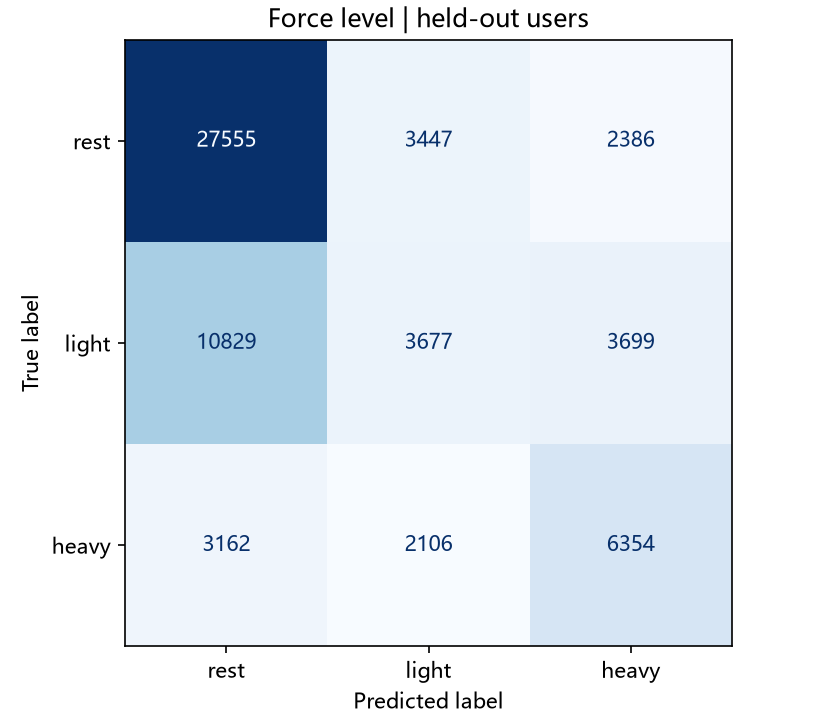
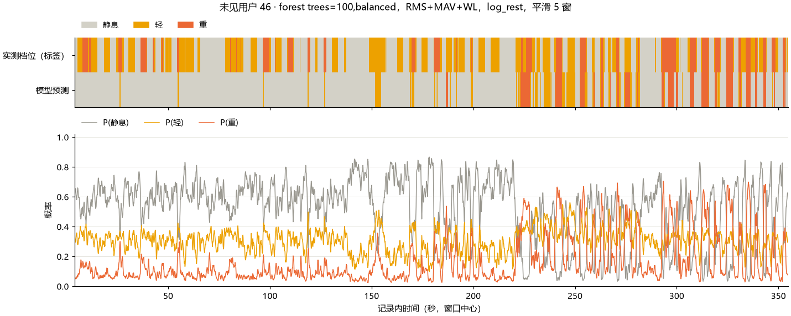

# D 任务补充 · 整只手三档力量分类

在 9 名留出用户的 63,215 个窗口上，三档力量分类器（静息 / 轻 / 重）的准确率为 **59.46%**，macro-F1 为 **0.511**。基线对比：

- 始终预测训练集多数类“静息”：52.82%、0.230；
- 把连续力量回归的预测按同一规则换算成档位：57.92%、0.376。

单独训练分类器明显好于“先回归再分档”。静息识别较好，“重”中等，“轻”大多被判为静息。

## 问题定义

putEMG-Force 的实验协议要求每名用户按三种力度出力：

- 静息；
- 约 25% 最大自主收缩力（MVC）；
- 约 50% MVC。

数据探索中，44 名用户的指令轨迹完全相同，`TRAJ` 平台值恰好是 `FORCE_MVC` 的 0、0.25、0.5 倍。因此三档有明确的物理含义，且与每个人自己的最大力相对，不受传感器单位影响。

| 档位 | 含义 | 实测力量 ÷ MVC |
| --- | --- | --- |
| 0 静息 | 手部放松 | < 12.5% |
| 1 轻 | 约 25% MVC | 12.5%–37.5% |
| 2 重 | 约 50% MVC | ≥ 37.5% |

阈值取三档名义值的中点，在看任何结果之前就已固定。模型只输入肌电，输出整只手的档位，不区分哪组手指在用力。

## 标签：实测力量 ÷ MVC

标签来自传感器实测力量，而不是实验指令，反映用户实际用了多大力。构造方式：

1. 每条记录的十路力量先减去开头 4 秒静息段的中位数，与回归实验相同。
2. 每路再减去以当前窗口为中心、10 秒滚动窗口内的 10% 分位数，去掉缓慢的零点漂移。
3. 取十路中**第二强**的传感器，除以该记录的 `FORCE_MVC`，按上表分档。

第 2、3 步是在训练用户上比较几种定义后确定的，比较依据是标签与实验指令档位的一致率（只读训练用户，不看验证和测试）：

| 标签定义（训练用户，每 3 条记录抽 1 条） | 与指令一致率 | 最差记录 | 静息占比 |
| --- | ---: | ---: | ---: |
| 最强传感器，只做开头调零 | 55.3% | 25.7% | 34% |
| 最强传感器，10 秒滚动基线 | 58.0% | 42.5% | 38% |
| 前两强平均，10 秒滚动基线 | 70.3% | 55.0% | 45% |
| **第二强，10 秒滚动基线（采用）** | **75.3%** | **66.6%** | 54% |

- **为什么用第二强**：每组手指至少有两个传感器，真正按压时两路同时升高；单个传感器漂移只抬高一路，不会被误判为出力。只用最强传感器时，漂移 50–100 个单位（10%–20% MVC）就足以把静息判成“轻”。
- **滚动基线**：它利用了窗口前后各 5 秒的实测力量，只用于构造真值。模型输入始终只有肌电，部署时不需要力量传感器。
- **一致率不可能达到 100%**：协议中有斜坡段，用户也有反应延迟。测试用户上，标签与指令档位的一致率为 73.9%。这意味着模型对标签的成绩有上限，标签本身约有四分之一窗口与指令不同。

## 数据和实验设计

- **数据与划分**：与回归实验完全相同。44 名用户的 85 份 `repeats_long` 记录，按用户分为训练 26、验证 9、测试 9 人（种子 42）；1024 点窗口、512 点步长；开头 4 秒校准窗口不参与训练与评估。复用回归实验的特征缓存。
- **各档占比**：训练、验证、测试的静息 / 轻 / 重分别约为 53/29/18%、54/29/17%、53/29/18%。
- **候选**，共 36 组，按验证用户 macro-F1 选型，测试用户不参与：
  - 特征尺度：`log`，或 `log_rest`（减去同记录静息特征）；
  - 特征组合：RMS+MAV，或 RMS+MAV+WL；
  - 模型：项目逻辑回归（L2 0.01）、随机森林 100 棵树（`min_samples_leaf=10`、`max_samples=0.3`），以及其类别平衡版本；
  - 概率平滑：同记录内对最近 1、3、5 个窗口的概率因果平均。
- **基线**：
  - 训练集多数类；
  - “回归换算”：已保存的连续力量回归模型的十路预测，按同一标签规则分档。

## 验证集选型

| 特征尺度 | 逻辑回归 | 随机森林 | 类别平衡随机森林 |
| --- | ---: | ---: | ---: |
| log | 0.446 | 0.474 | 0.453 |
| log_rest | 0.480 | 0.521 | **0.541** |

表中为未平滑时两组特征中较好者的 macro-F1。减去静息特征依然是最有效的改进，与回归实验一致。

获选配置：log_rest、RMS+MAV+WL、类别平衡随机森林、概率平滑 5 窗，验证 macro-F1 0.563。[全部 36 组候选](validation.csv)

## 留出用户结果

| 方法 | 准确率 | macro-F1 |
| --- | ---: | ---: |
| **三档分类器** | **59.46%** | **0.511** |
| 回归预测换算档位 | 57.92% | 0.376 |
| 训练集多数类（静息） | 52.82% | 0.230 |

| 档位 | 窗口数 | 精确率 | 召回率 | F1 |
| --- | ---: | ---: | ---: | ---: |
| 静息 | 33,388 | 0.663 | 0.825 | 0.735 |
| 轻 | 18,205 | 0.398 | 0.202 | 0.268 |
| 重 | 11,622 | 0.511 | 0.547 | 0.528 |



- **“轻”是主要难点**：18,205 个“轻”窗口中有 10,829 个被判为静息。25% MVC 带来的肌电变化小，跨用户时与静息难以区分；部分“轻”标签也可能是残余漂移造成的噪声。
- **“重”与静息较少混淆**：真实为“重”的窗口中 27% 被判为静息。
- **与实验指令对比**：模型预测与指令档位的一致率为 58.6%，macro-F1 0.468。

[逐档数值](per_class.csv) · [混淆计数](confusion.csv)

### 不同用户

各测试用户的 macro-F1 从 0.372（用户 15）到 0.604（用户 04）。用户 16 的模型准确率（59.5%）低于全部预测为静息（64.7%），说明对个别用户，三档分类仍不如简单规则。[逐用户数值](per_user.csv)

### 档位时间线

下图展示用户 46 的一条记录。按测试 macro-F1 排序，该用户位于中位，此图仅用于展示。上方两行色带分别为实测档位与模型预测，下方为三档概率。



- **约 220 秒前**：依次按压前三组手指，模型几乎全判为静息，与回归实验中这几组手指几乎无法识别一致。
- **约 220 秒后**：第四组手指和多指同时出力阶段，模型能跟上大部分“重”出力。

[该记录的逐窗结果](example_predictions.csv)

## 结论与限制

- 三档分类对未见用户有一定能力：macro-F1 0.511，多数类基线 0.230；也好于把回归结果换算成档位。可以作为“是否在用力、是否用力较大”的粗略判断，但“轻”档目前不可靠。
- 标签与指令的一致率约 74%，模型成绩受标签噪声限制。若将来确认传感器语义与零点校准方法，标签质量可以进一步提高。
- 档位相对每个人的 MVC 定义。部署时模型不需要知道 MVC，只看肌电；要评估新数据的档位准确率，仍需力量传感器和 MVC。
- 测试只有 9 名用户；窗口重叠，窗口数不等于独立样本数。

## 复现与模型文件

需先完成回归实验，以生成特征缓存和回归模型；之后：

```powershell
.\.venv\Scripts\python.exe -m emginsight.force.levels
```

使用特征缓存时本机约 3 分钟。

- **模型文件**：`results/runs/force/force_level_model.joblib`，约 23.5 MB，被 Git 忽略。保存后会重新读取并复算全部测试窗口，确认与本次预测完全一致。[model_card.json](model_card.json) 记录校验值、超参数和训练用户。
- **部署**：批处理预测命令 `python -m emginsight.force.predict` 和指力 Docker 镜像会同时输出连续力量和三档。输入含 `FORCE_*` 与 `FORCE_MVC` 时，附带三档对照指标。见[部署说明](../../../deploy/force/README.md)。
