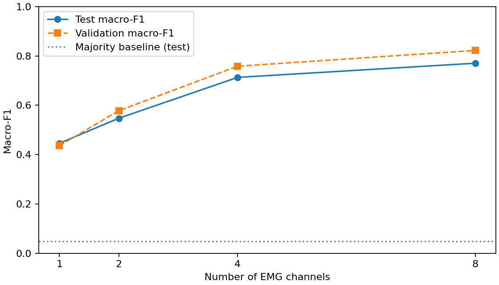

# 手势通道减少实验

## 方法
复用六类手势任务、seed=42 用户划分、200 点窗口、100 点步长与 20 ms 断点阈值。
固定原实验获选的 100 棵随机森林及 RMS/MAV/WL；标准化仅在训练用户上拟合。
从零开始逐步加入验证集 macro-F1 最好的通道，并列时选编号较小者；报告嵌套的 1/2/4/8 路子集。
全部子集确定后才计算测试指标，不按测试成绩挑选通道。这里不应用未知拒识，准确率的分母是全部六类有效测试窗口。

## 结果
|通道数|通道编号|验证 F1|测试 F1|测试准确率|较八路 F1 降幅|
|---|---|---|---|---|---|
|1|8|0.4361|0.4458|0.4518|0.3245|
|2|5,8|0.5778|0.5473|0.5523|0.2230|
|4|2,4,5,8|0.7581|0.7129|0.7171|0.0574|
|8|1,2,3,4,5,6,7,8|0.8221|0.7703|0.7737|0.0000|

训练多数类基线测试 macro-F1：0.0487。



## 解读与限制
表中降幅为八通道测试 F1 减去对应子集 F1，负数表示子集更高。更少通道是否值得使用，应结合实际降幅判断，不预设性能一定随通道数单调增长。
前向选择是贪心搜索，不保证所有同大小组合中的最优子集；同一验证集的多次比较也可能产生选择偏差。
各用户指标见 per_user.csv；不同用户窗口相关，不能把窗口数当独立样本数来声称统计显著。
该测试用户集合在原项目中已经使用过，本实验属于探索性扩展，不是新的独立未触碰测试集。
通道编号只对应本数据集传感器；未实际测量硬件成本、延迟或耗电，不能据此声称减少了多少成本。

## 复现
在仓库根目录安装 requirements.txt 并准备 UCI 原始数据后运行：

```bash
python -m emginsight.gesture.channel_ablation
```

输出目录默认 results/gesture/channel_ablation，与原分类报告分开。metrics.json 保存数据哈希、实际用户名单、参数与版本。
