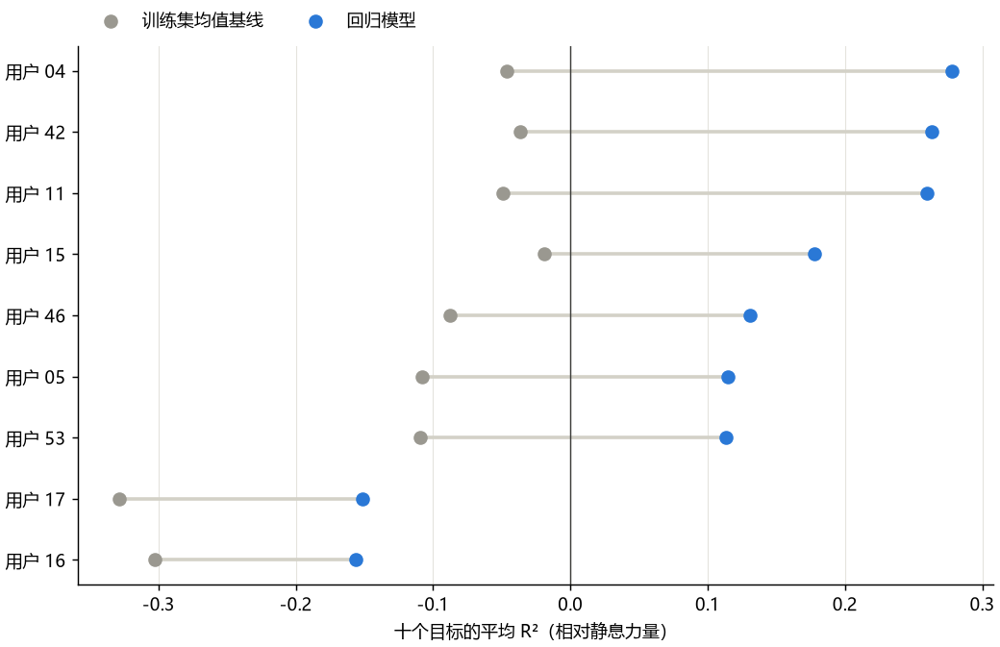
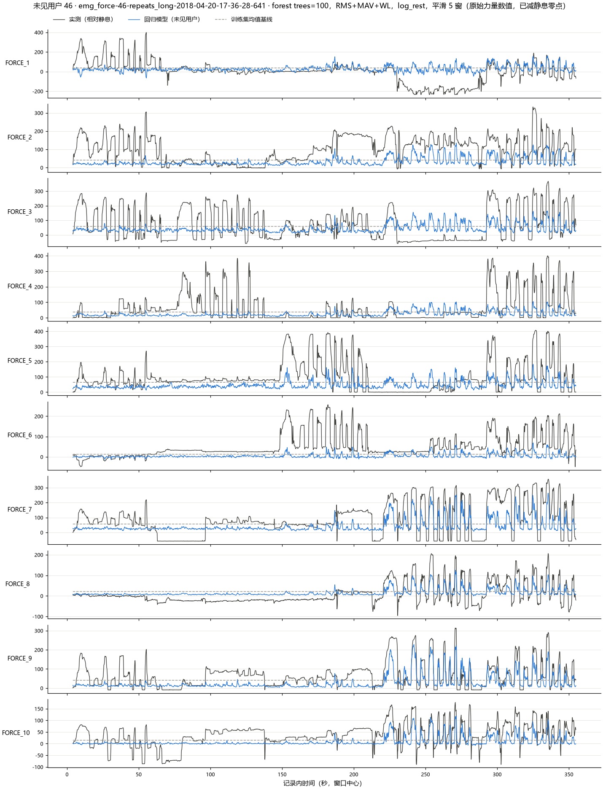

     # D 任务 · putEMG-Force 手指力量回归

在 9 名留出用户的 63,215 个窗口上，获选随机森林对十路力量的平均 MAE 为 **53.42**，平均 RMSE 为 **73.21**，平均 R² 为 **0.238**。训练集均值基线对应为 62.37、83.46 和 −0.006。模型在全部 10 个目标、全部 9 名测试用户上的 RMSE 都低于基线，7 名用户的 R² 为正。

力量单位：putEMG-Force 原始数值。数据集没有给出物理单位，所以 MAE、RMSE 都不是牛顿。主结果的目标是“相对静息力量”：每条记录减去自己开头 4 秒静息段的力量中位数。

## 数据和实验设计

- **数据**：官方 44 名用户的全部 `repeats_long` 实验记录，本地共 85 份 CSV。records.txt 中另有 4 份未下载：用户 03 第二天、用户 10、27、50 各一份。只用 `repeats_long` 一类，保证训练、验证、测试的任务一致；`bias`、`mvc` 不使用。
- **划分**：调用 A 的按用户划分，种子 42、比例 0.6/0.2/0.2。训练 26 人（50 份记录，175,652 窗）、验证 9 人（17 份，59,709 窗）、测试 9 人（18 份，63,215 窗）。同一用户的全部日期在同一组。[用户名单](metrics.json)
- **预处理**：每条记录整段做固定的因果 20–500 Hz 四阶 Butterworth 带通，名义采样率 5120 Hz。1024 点窗口、512 点步长，名义约 200/100 毫秒。
- **静息校准**：每条记录开头约 4.5 秒的 `TRAJ_1`–`TRAJ_4` 均为 0，即没有出力指令。程序确认前 4 秒全为 0 后，把这段作为校准段：
  - 用其力量中位数作为零点；
  - 用其中完整窗口的平均 RMS/MAV/WL 作为静息肌电特征。

  校准段的窗口不参与训练和评估。`TRAJ` 只用来确认这段是静息，不作为预测目标或模型输入。85 份记录都通过检查。这一步相当于使用前先静置 4 秒、给传感器调零，是对实际使用条件的假设。
- **目标**：窗口内 `FORCE_1`–`FORCE_10` 实测均值减去零点，形状为 (窗口数, 10)。十列并不对应十个独立手指：数据探索时，`FORCE_1–2`、`3–4`、`5–6`、`7–10` 分别主要随 `TRAJ_1`–`TRAJ_4` 变化。
- **候选**，按验证用户十个目标的平均 RMSE 选型，测试用户不参与：
  - 特征尺度：原始（raw）、取对数（log）、对数减同记录静息特征（log_rest）；
  - 特征组合：RMS+MAV，或 RMS+MAV+WL；
  - 模型：岭回归 α=1、10、100；随机森林 100 棵树（`min_samples_leaf=10`、`max_samples=0.3`、种子 42）；
  - 预测平滑：在同一记录内对最近 1、3、5 个窗口的预测取平均，只用当前和过去的窗口。

  共 72 组。标准化只用训练窗口拟合。
- **基线**：B 任务的 `MeanRegressor`，输出训练窗口目标的均值。

## 验证集选型

各特征尺度的最佳平均 RMSE（未平滑）：

| 特征尺度 | 岭回归（RMS+MAV+WL，α=100） | 随机森林（RMS+MAV+WL） |
| --- | ---: | ---: |
| raw | 82.34 | 79.37 |
| log | 81.32 | 79.37 |
| log_rest | 76.91 | **73.86** |

- 对数特征改善了岭回归。随机森林只按特征排序切分，所以 raw 和 log 的结果相同。
- 减去同记录静息肌电后，两种模型都明显变好：随机森林从 79.37 降到 73.86。这说明用户、佩戴之间的肌电幅度差异是主要障碍之一。
- 加入 WL 在 log_rest 下略有帮助。
- 因果平滑 5 窗把最佳候选再降到 **71.73**（验证 R² 0.288）。获选配置：log_rest、RMS+MAV+WL、随机森林 100 棵树、平滑 5 窗。[全部 72 组候选](validation.csv)

平滑 5 窗相当于对过去约 0.6 秒的预测取平均，会带来少量响应延迟。

## 留出用户结果

| 目标 | 模型 MAE | 模型 RMSE | 基线 MAE | 基线 RMSE | 模型 R² | 模型 Pearson r |
| --- | ---: | ---: | ---: | ---: | ---: | ---: |
| FORCE_1 | 98.74 | 129.55 | 103.68 | 132.07 | 0.032 | 0.24 |
| FORCE_2 | 48.81 | 68.82 | 56.34 | 75.63 | 0.172 | 0.42 |
| FORCE_3 | 75.55 | 97.30 | 84.18 | 104.07 | 0.120 | 0.37 |
| FORCE_4 | 54.68 | 74.45 | 55.10 | 76.39 | 0.048 | 0.27 |
| FORCE_5 | 74.97 | 101.17 | 86.43 | 110.59 | 0.139 | 0.39 |
| FORCE_6 | 31.10 | 49.69 | 32.84 | 53.24 | 0.128 | 0.36 |
| FORCE_7 | 57.50 | 79.80 | 80.37 | 107.85 | 0.452 | 0.69 |
| FORCE_8 | 26.48 | 35.90 | 35.06 | 49.42 | 0.468 | 0.72 |
| FORCE_9 | 37.17 | 55.89 | 54.00 | 75.72 | 0.455 | 0.68 |
| FORCE_10 | 29.19 | 39.56 | 35.73 | 49.64 | 0.363 | 0.63 |
| **平均** | **53.42** | **73.21** | 62.37 | 83.46 | **0.238** | 0.48 |

MAE、RMSE 为原始力量数值，已减去静息零点。[逐目标数值](per_target.csv)

- 跟随 `TRAJ_4` 的 `FORCE_7`–`FORCE_10` 预测最好，R² 0.36–0.47。
- 跟随前三条轨迹的 `FORCE_1`–`FORCE_6`，R² 只有 0.03–0.17。
- `FORCE_1` 与 `FORCE_4` 几乎没有超过基线。

### 不同用户



- 用户间差异很大：模型的平均 R² 从 −0.156（用户 16）到 0.278（用户 04）。
- 用户 16、17 的模型 R² 为负，但仍高于各自的基线（−0.30、−0.33）。
- 9 人的模型 RMSE 都低于基线，降幅为 5.5%–16.5%。

[逐用户数值](per_user.csv)

### 预测与实测曲线

下图展示用户 46 的一条记录。按测试平均 R² 排序，该用户位于中位，此图仅用于展示。



- **出力时段**：模型能识别何时出力、哪一组手指在出力。约 220 秒后第四组手指与多指阶段，预测的起落与实测基本同步。
- **幅度偏小**：预测普遍只有实测的一半左右，跨用户回归会向训练均值收缩。
- **零点漂移**：同一记录中，力量零点仍会在出力后漂移（如 `FORCE_1` 在 230–290 秒降到约 −200，`FORCE_7` 在 60–100 秒降到约 −60）。肌电无法预测这类偏移，开头一次调零也不能完全消除。

[该记录的逐窗预测](example_predictions.csv)

### 静息校准的贡献

用同一获选配置，改为预测未调零的原始力量：

| 设置 | 模型 RMSE | 基线 RMSE | 模型 R² |
| --- | ---: | ---: | ---: |
| 相对静息力量（主结果） | 73.21 | 83.46 | 0.238 |
| 原始力量，不调零 | 76.60 | 84.69 | 0.173 |

不调零时模型仍然优于基线；调零后误差和 R² 都进一步改善。

## 与上一版的比较

上一版只有 3 名用户（训练、验证、测试各 1 人）。在用户 03 上，模型的平均 RMSE 为 68.39，基线为 71.16；R² 为 −0.498，略低于基线的 −0.485。

本版做了三点改动：
- 用 26 名训练用户；
- 用静息段做力量调零和肌电归一化；
- 加入因果平滑。

改动后模型在新用户上稳定优于均值基线。两版的测试用户不同，RMSE 数值不能直接相比。

## 结论与限制

- 在 26 名用户上训练的时域特征加随机森林，**对未见用户的手指力量有一定预测能力**：全部测试用户的误差低于均值基线，平均 R² 0.238。但还远不能精确估计力量：预测幅度偏小，前三组手指区分较弱，且个别用户 R² 为负。
- 结果依赖“每次使用前静置 4 秒”的校准假设。若实际使用无法静息校准，应参考上一节的不调零结果（R² 0.173）。
- 窗口有 50% 重叠，且同一用户贡献约 7,000 个窗口，所以窗口数不是独立样本数。用户层面只有 9 名测试用户。
- 力量物理单位、各列与手指的对应关系未确认；没有使用 bias、mvc 校准记录。
- 可以继续的方向：
  - 按用户交叉验证，评估更多测试用户；
  - 加入频域特征或更长的上下文窗口；
  - 处理记录内的零点漂移；
  - 确认 MVC 语义后，尝试按 MVC 归一化。

  这些都应先在验证用户上确定。

## 复现

在项目根目录安装依赖，将各用户的 `repeats_long` CSV 解压到 `data/raw/EMG_data_for_putemgforce/emg_force_XX/`（见[数据处理说明](../../../src/emginsight/putemg_force/README.md)）。以下命令从原始 CSV 重新训练，生成本目录全部表格与图。

```powershell
.\.venv\Scripts\python.exe -m pip install "scikit-learn==1.7.2" "pandas==2.3.3"
.\.venv\Scripts\python.exe -m emginsight.putemg_force.experiment
.\.venv\Scripts\python.exe -m pytest tests/putemg_force/test_experiment.py
```

- 首次运行需读取约 33 GB CSV 并提取特征，特征提取约 7 分钟。每份记录的特征缓存在被 Git 忽略的 `results/runs/putemg_force/`，再次运行会跳过这一步，选型、训练和保存模型约 7 分钟。缓存目录还保存全部测试窗口的预测 `putemg_force_test_predictions.csv.gz`。
- `--data-dir`、`--output-dir`、`--cache-dir`、`--model-path` 可改路径。
- 运行环境：Windows、Python 3.12.14、scikit-learn 1.7.2、pandas 2.3.3、NumPy 2.3.5、SciPy 1.18.1、Matplotlib 3.11.2。

## 模型文件

同一命令会把获选模型保存为 `results/runs/putemg_force/force_model.joblib`（约 63 MB，被 Git 忽略）。文件内容：

- 训练好的标准化器和随机森林；
- 特征尺度、特征组合、平滑窗口；
- 预处理参数（滤波、窗口、4 秒静息校准）；
- 训练用户名单和 scikit-learn 版本。

保存后，程序会重新读取文件，对全部测试窗口再预测一次，与训练时的预测比较，最大差 5.9×10⁻¹²。随机森林按树并行预测时，累加顺序不固定，末位会有约 10⁻¹³ 的浮点差异；保存的模型改为单线程预测，同一输入每次输出完全一致。

[model_card.json](model_card.json) 记录本次文件的大小、SHA-256、全部超参数、训练用户和测试指标。

**重建同一模型**：在相同数据和 scikit-learn 1.7.2 下运行上面的复现命令即可。种子固定为 42，本报告的测试指标已在两次独立重跑中逐位一致。重新训练得到的文件 SHA-256 不保证相同，因为文件内还包含 joblib 压缩等细节。

**直接使用已训练模型**：从网盘下载 `force_model.joblib`，放到上述路径，或用 `--model-path` 指定。读取时会核对校验值和库版本：

```python
from emginsight.putemg_force import load_force_model

model = load_force_model("results/runs/putemg_force/force_model.joblib",
                         sha256="9df272ae08e81902af7df4d6bd76202c01557037a78e0003e403e9e616d2808d")
# X、rest：按本实验流程提取的 72 列 RMS/MAV/WL 特征与同记录静息特征；records：每行所属记录编号。
force = model.predict(X, rest, records)   # (窗口数, 10)，相对静息力量，原始数值
```

上传网盘后，请在此处补充下载链接：`待上传`。

**用模型预测新数据**可运行 `python -m emginsight.putemg_force.predict --input 记录.csv --output-dir 输出目录`，也可使用 Docker 镜像。输入需要 24 路肌电，记录开头 4 秒保持静息。详见[部署说明](../../../deploy/force/README.md)。

## 补充：三档力量分类

除连续力量外，还训练了整只手三档力量分类器（静息 / 轻约 25% MVC / 重约 50% MVC），测试 macro-F1 0.511，多数类基线 0.230。把本报告的回归预测换算成档位只有 0.376。见[三档力量报告](../levels/report.md)。
