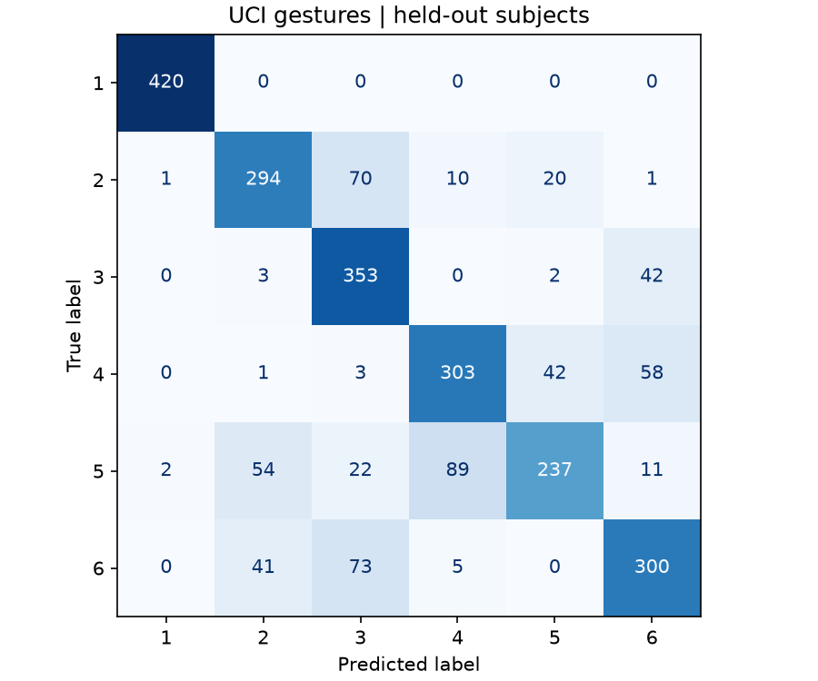
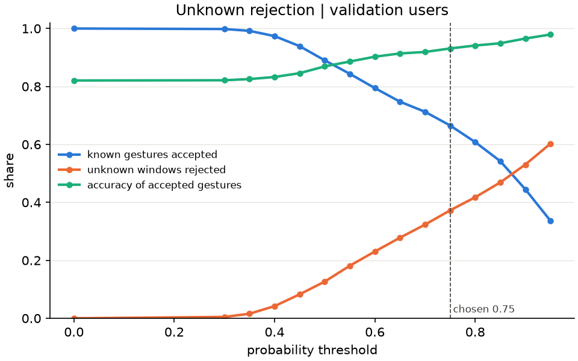

# C 任务 · UCI 六类手势识别

在 7 名留出用户的 2,457 个窗口上，100 棵树的随机森林准确率为 **77.61%**，macro-F1 为 **0.7728**。训练集多数类为静息，对应测试准确率为 17.09%，macro-F1 为 0.0487。

## 数据和实验设计

- 参考 Akshar Khatrani 的多类手势示例，比较不同特征组合在跨用户分类中的表现。本实验调用本仓库 A/B 的实现，使用全部 8 个通道。参考实现见[原项目](https://github.com/Akshar51k/emg_hand_gesture_classifier/tree/7383e1d3cae8960b9089c85b23f77c7da7aebce6)。
- 沿用 A 的用户划分，种子 42。训练、验证、测试分别为 22、7、7 人，对应 7,769、2,860、2,457 个有效窗口。用户 34 的一份记录末行缺列，跳过该文件，其另一份记录参与训练。[用户与异常记录](metrics.json)
- 每条记录独立分窗，窗长 200 点，步长 100 点，最大时间间隔 20 毫秒。保留单一标签的完整窗口。主任务预先限定静息及五种动作（1–6）。未标注 0 排除；标签 7 仅在训练组有窗口，六类实验排除该标签。
- 每个通道取 RMS、MAV，或再加入波形长度 WL，共 16 或 24 个特征。标准化只拟合训练组。逻辑回归比较 L2 系数 0.001、0.01，kNN 比较 5、15 个邻居，随机森林比较 20、100 棵树（种子 42）。按验证 macro-F1 选型，并列时取首个候选。恢复随机森林后沿用上一轮的测试用户，未增加独立测试集。

## 验证集选型

| 特征 | 逻辑回归最佳 macro-F1（L2） | kNN 最佳 macro-F1（k） | 随机森林最佳 macro-F1（树数） |
| --- | ---: | ---: | ---: |
| RMS、MAV | 0.8109（0.01） | 0.8080（15） | 0.8201（100） |
| RMS、MAV、WL | 0.8144（0.01） | 0.7991（15） | **0.8219（100）** |

随机森林加入 WL 后，验证 macro-F1 从 0.8201 升至 0.8219。详见[全部十二组候选](validation.csv)。

## 留出用户表现

| 手势 | 窗口数 | 精确率 | 召回率 | F1 |
| --- | ---: | ---: | ---: | ---: |
| 1 静息 | 420 | 0.993 | 1.000 | 0.996 |
| 2 握拳 | 396 | 0.748 | 0.742 | 0.745 |
| 3 腕屈 | 400 | 0.678 | 0.882 | 0.767 |
| 4 腕伸 | 407 | 0.744 | 0.744 | 0.744 |
| 5 桡偏 | 415 | 0.787 | 0.571 | 0.662 |
| 6 尺偏 | 419 | 0.728 | 0.716 | 0.722 |

最多的单向误判是桡偏被判为腕伸（89/415），其次是尺偏被判为腕屈（73/419）。图中行为真实标签，列为预测标签。[逐类数值](per_class.csv) · [混淆计数](confusion.csv)



各用户的准确率从 62.82%（用户 15）到 99.07%（用户 09）。总体指标按窗口统计，相邻窗口有重叠，且每名用户贡献的窗口数不同。结果仅覆盖本次留出划分及六类纯手势窗口。[逐窗预测与来源](test_predictions.csv)

## “未知”拒识

上面的六类模型对任何窗口都会给出六类之一。实际使用时还会遇到动作之间的过渡、没有训练过的手势（如 UCI 第 7 类手掌伸展）和未标注时段，因此增加“未知”输出：

- **规则**：模型不变，当最大类别概率低于阈值时输出 0（未知）。
- **“未知”窗口的定义**：窗口内全为未标注 0、全为第 7 类，或包含多个标签。“已知”是单一标签 1–6 的窗口，即上文评估的窗口。
- **阈值选择**：只用 7 名验证用户，在 0.30–0.95（步长 0.05）中按七类 macro-F1（六类 + 未知）选择，结果为 **0.75**。测试用户不参与。



| 7 名测试用户 | 不拒识 | 拒识（阈值 0.75） |
| --- | ---: | ---: |
| 七类 macro-F1 | 0.336 | **0.402** |
| 已知手势被接受的比例 | 100% | 59.0% |
| 被接受手势的准确率 | 77.61% | **93.59%** |
| 未知窗口被拒识的比例 | 0% | 33.8% |

窗口数：已知 2,457、未知 5,565。[验证集各阈值结果](rejection_validation.csv)

拒识后，被接受的手势准确率从 77.6% 升到 93.6%，代价是约 41% 的真实手势被判为未知。它更像一个“不确定”标记：

- 对模型拟合较好的用户 09，两份记录分别只有 14% 和 19% 的窗口被判为未知；
- 对最难的用户 15，约一半窗口被判为未知，而被接受的窗口准确率从约 63% 升到 88%–97%。

未知窗口只有约三分之一被拒识，原因之一是 UCI 的未标注时段大多是两次动作之间的静息。模型以高置信度判为“静息”，这在实际中并无不妥，但按上述定义被计为未拒识。因此这里的“未知”真值本身有噪声，拒识率应结合这一点理解。

## 复现

在项目根目录安装依赖后，将 UCI 数据解压到 `data/raw/EMG_data_for_gestures-master/`，保留用户子目录。以下命令使用本地原始记录重新训练，生成结果表与混淆矩阵。

```powershell
.\.venv\Scripts\python.exe -m pip install "scikit-learn==1.7.2" "pandas==2.3.3"
.\.venv\Scripts\python.exe -m emginsight.uci_gesture.experiment
```

也可用 `--data-dir` 指定数据位置，`--output-dir` 指定输出目录，`--model-path` 指定模型文件位置。本机 Windows / Python 3.12 环境中，应用程序控制阻止了 scikit-learn 1.9.1 的 `_bitset` 扩展加载，以上官方 wheel 版本已验证可运行。

## 模型文件与识别新数据

同一命令会把获选模型保存为 `results/runs/uci_gesture/gesture_model.joblib`（约 2.2 MB，被 Git 忽略）。文件内容：

- 训练好的标准化器和 100 棵树随机森林，以及“未知”拒识阈值；
- 所用的 24 列特征；
- 分窗参数（200 点窗口、100 点步长、20 ms 断点规则）；
- 训练用户名单和 scikit-learn 版本。

保存后，程序会重新读取文件，复算 2,457 个测试窗口，确认与本次预测完全相同。重跑时种子固定、随机森林单线程预测，本目录的结果表与上一版逐字节一致。

[model_card.json](model_card.json) 记录文件大小、SHA-256、全部超参数和测试指标。

识别新的原始文件（UCI 格式 txt 或含 `channel1`–`channel8` 的 CSV）：

```powershell
.\.venv\Scripts\python.exe -m emginsight.uci_gesture.predict --input 文件或目录 --output-dir 输出目录
```

输出逐窗手势（含 0 未知）、六类结果 `raw_prediction`、六类概率和图；有 `class` 列时附带六类准确率、macro-F1 和拒识指标。Docker 打包、输入输出格式和一致性验证见[部署说明](../../../deploy/gesture/README.md)。
